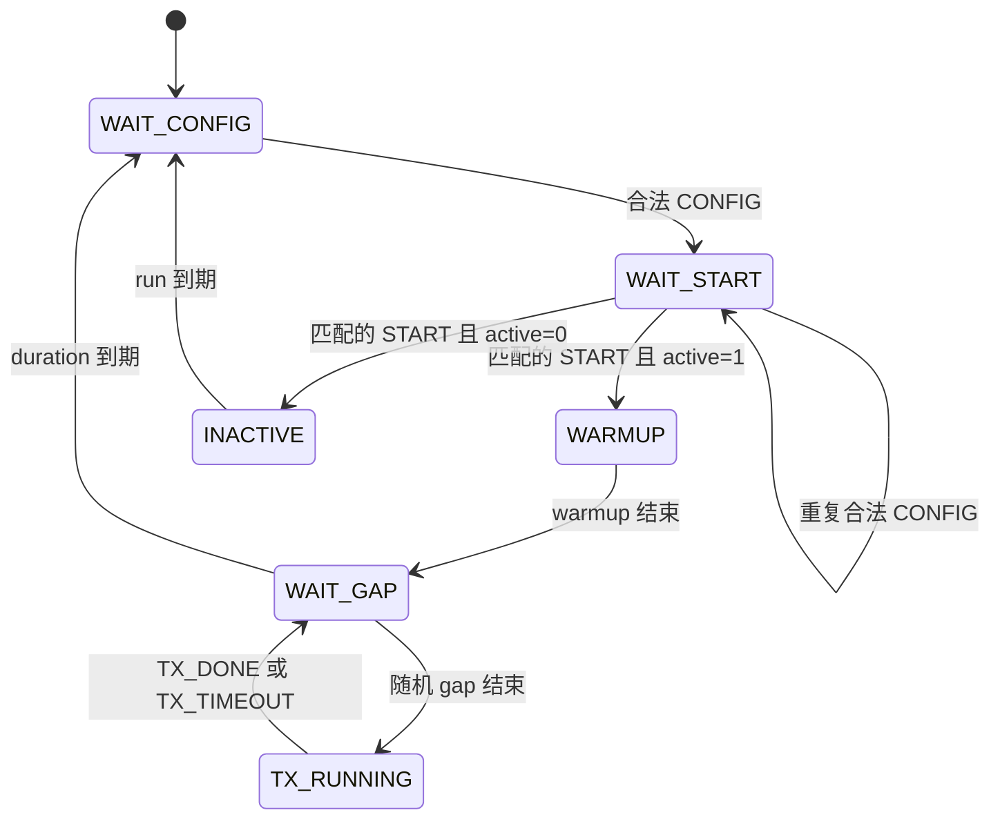

# LoRa 节点：STM32F103C8T6 + SX1276

## 1. 节点职责

每块板烧录唯一的 `EXPERIMENT_NODE_ID=1..15`。节点上电后监听控制信道，接收合法 CONFIG 和 START，根据 active mask 决定是否参与，并按由 `N` 和 `G` 决定的指数随机间隔发送 20 字节数据包。

## 2. 当前固件入口

- Keil 工程：`LoraSTMacF103.uvprojx`
- 主状态机：`apps/main.c`
- 协议与 CRC：`apps/experiment_protocol.c`、`apps/experiment_protocol.h`
- 芯片定义：`STM32F103xB`
- 当前工程配置：`EXPERIMENT_NODE_ID=2`，输出名为 `LoraSTMacF103_Node02`

不要把 Node02 的 HEX 烧给 Node01。每次改 ID 时同时改输出名，并保存/构建后再烧录。

## 3. 关键引脚

以工程 `boards/board-config.h` 和 SX1276 board 文件为准。实验中特别需要认识：

| 功能 | STM32F103 引脚 | 说明 |
|---|---|---|
| USART1 TX | PA9 | 可选日志输出；没有 USB-TTL 时不连接 |
| USART1 RX | PA10 | 当前实验不依赖 |
| SWDIO | PA13 | ST-Link 下载/调试 |
| SWCLK | PA14 | ST-Link 下载/调试 |
| 板载 LED | PC13 | 低电平点亮；用于无串口状态判断 |
| SX1276 RESET | PB9 | 射频芯片复位 |
| SX1276 NSS | PA4 | SPI 片选 |
| SX1276 SCK | PA5 | SPI 时钟 |
| SX1276 MISO | PA6 | SPI 数据输入 |
| SX1276 MOSI | PA7 | SPI 数据输出 |
| SX1276 DIO0 | PB0 | TxDone/RxDone 等中断 |
| SX1276 DIO1 | PB1 | 射频中断 |
| SX1276 DIO2 | PB10 | 射频中断 |
| SX1276 DIO3 | PB11 | 射频中断 |
| SX1276 DIO4 | PB12 | 射频中断 |
| SX1276 DIO5 | PB13 | 射频中断 |

以上是当前工程 `boards/board-config.h` 的实际定义，不要仅凭其他“蓝板”或 LoRa 模块的通用引脚图重新接线。ST-Link 至少连接 `SWDIO`、`SWCLK`、`GND`，并让目标板正确供电。ST-Link 的 3.3 V 是否给板供电取决于你的模块接法；绝不能同时接入冲突电源。

## 4. 生成 15 份固件

对每个节点执行：

1. 打开 `LoraSTMacF103.uvprojx`。
2. `Project -> Options for Target -> C/C++ -> Define`。
3. 设置 `EXPERIMENT_NODE_ID=1`，范围必须是 1 到 15。
4. 在 `Output` 页把 Name 设置为 `LoraSTMacF103_Node01`。
5. 勾选 `Create HEX File`，按 `F7` 构建。
6. 在工程目录 `Objects` 中确认 `LoraSTMacF103_Node01.hex`。
7. 烧录 Node01，并立刻给板子贴 Node01 标签。
8. 对 Node02 至 Node15 重复，ID 和输出名同时递增。

不要一次改完 ID 后覆盖同一个 HEX 名；保留 15 份可追溯文件。

## 5. 下载方式

Keil 正常配置：

1. `Options for Target -> Device` 选择 `STM32F103C8`。
2. `Debug` 选择 `ST-Link Debugger`。
3. `Utilities` 选择 `Use Target Driver for Flash Programming`。
4. `Settings -> Flash Download` 中保留 STM32F10x 128 KB 对应算法。
5. 按 `F8` 下载当前构建的 HEX。

若 Keil 对兼容芯片持续报 device mismatch/internal command error，可用 pyOCD 明确指定器件和 DFP pack；执行前必须再次确认 HEX 的节点编号：

```powershell
pyocd flash --target stm32f103c8 --pack "C:\Users\chengjing\AppData\Local\Arm\Packs\.Download\Keil.STM32F1xx_DFP.2.4.1.pack" "Objects\LoraSTMacF103_Node01.hex"
```

## 6. 节点状态机



节点运行完会重新进入 `WAIT_CONFIG`，因此下一场实验无需重新上电，但必须发送新的完整 CONFIG + START。

## 7. 没有 USB-TTL 时如何判断

PC13 LED 为低电平点亮：

| LED 表现 | 状态 | 结论 |
|---|---|---|
| 上电后熄灭 | WAIT_CONFIG | 固件已进入监听控制帧 |
| 收到控制后常亮 | WAIT_START | CONFIG CRC 正确且参数已接受 |
| 随 START 熄灭 | WARMUP/WAIT_GAP | START 已接受 |
| 约 371 ms 亮一下 | TX_RUNNING | 射频发送函数正在执行 |
| run 结束后熄灭 | WAIT_CONFIG | 等待下一轮 CONFIG |

LED 是辅助观察，不足以证明 TX_DONE、精确包数或 CRC。正式判断必须依赖接收端解码。

## 8. 20 字节 payload

| 字节 | 字段 | 说明 |
|---:|---|---|
| 0..1 | magic | ASCII `SP` |
| 2 | version | 1 |
| 3 | node_id | 1..15，各节点不同 |
| 4..7 | run_id | 来自 CONFIG |
| 8..11 | sequence | 每个 run 从 0 递增 |
| 12 | phy_profile_id | 当前为 0 |
| 13 | traffic_profile_id | 决定 G |
| 14..17 | prbs_word | 由 seed、run、节点和序号确定 |
| 18..19 | application_crc | 对前 18 字节做 CRC16 |

不同节点的 payload 不相同，至少 `node_id`、`prbs_word` 和 CRC 不同；同一节点的不同包还有递增 sequence。

## 9. CRC 是否真的能校验

有两层独立校验：

1. SX1276 的 LoRa PHY CRC：由射频芯片生成和检查，检测调制帧级错误。
2. payload CRC16：固件对 payload 前 18 字节计算 CRC16，写在第 18..19 字节；Python `decode_data_payload()` 对收到的前 18 字节重新计算并比较。

所以 payload CRC 是真实校验，不是固定占位值。只有完整后端最终输出原始 20 字节，并调用 `decode_data_payload()` 或同算法校验，应用层 CRC 才真正参与实验判决。

## 10. 单节点验收

每块板都要单独通电完成一次：

1. active-nodes 只选择该节点，`G=0.25`，30 s。
2. LED 必须经历熄灭、CONFIG 后常亮、START 后熄灭、发送时闪亮。
3. 接收端至少解出若干 20 字节数据包。
4. 解出的 `node_id` 必须与板贴纸一致。
5. `run_id` 正确，sequence 从 0 附近开始且单调增加。
6. PHY CRC 和 payload CRC 均通过。
7. 记录接收功率和频偏；明显异常的板先排查，不进入 15 节点实验。
