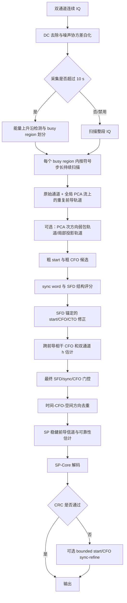

# SP-Decoder 前端检测与同步估计详解

> 本文档描述当前代码实际执行的双通道 B210 离线接收前端，而不是一个尚未落地的理想化设计。文中的“默认路径”对应 `sp_node01_receiver.py` 不加 `--full-refine` 时的行为；可选路径会单独标注。前端在论文中的定位应是 SP-Decoder 的输入接口与工程依赖，不应在没有独立对比实验的情况下被表述为核心算法贡献。

## 1. 前端的任务、输入与输出

### 1.1 输入

前端输入是 B210 两个同步接收通道的连续复基带采样：

$$
\mathbf y[n]
=
\begin{bmatrix}
y_0[n]\\
y_1[n]
\end{bmatrix}
\in\mathbb C^2.
$$

当前实测 LoRa 参数为：

| 参数 | 当前值 |
|---|---:|
| SF | 10 |
| BW | 125 kHz |
| 采样率 $F_s$ | 500 kHz |
| 过采样率 $L=F_s/\mathrm{BW}$ | 4 |
| LoRa bin 数 $M=2^{\mathrm{SF}}$ | 1024 |
| 每符号采样数 $N_s=LM$ | 4096 |
| 符号时长 $T_s=M/\mathrm{BW}$ | 8.192 ms |
| 前导码长度 | 8 symbols |
| sync word | `0x34` |
| payload 长度 | 20 bytes |
| CR | 4/5 |
| PHY CRC | 开启 |

一个 CFO bin 对应的频率为

$$
\Delta f_{\mathrm{bin}}
=
\frac{\mathrm{BW}}{M}
\approx 122.07\ \mathrm{Hz}.
$$

因此代码中以 bin 为单位的连续 CFO $\nu$ 对应

$$
\widehat f_{\mathrm{CFO}}
=
\widehat\nu\frac{\mathrm{BW}}{M}.
$$

### 1.2 每个候选包的输出

前端为每个包候选输出

$$
\mathcal E_u
=
\left(
\widehat\tau_u,\,
\widehat\delta_u,\,
\widehat\nu_u,\,
\widehat{\mathbf h}_u,\,
\Gamma_u
\right),
$$

其中：

- $\widehat\tau_u$：整数起点 `start_sample`；
- $\widehat\delta_u$：分数采样偏移 `sto_samples`；
- $\widehat\tau_u+\widehat\delta_u$：最终连续时间起点；
- $\widehat\nu_u$：连续 CFO，单位为 LoRa FFT bin；
- $\widehat{\mathbf h}_u\in\mathbb C^2$：双通道复信道估计；
- $\Gamma_u$：前导、sync word、SFD、相干性等诊断分数。

前端不知道节点 ID、payload、真实发送时刻。manifest 中的发送计划只用于最终统计，不参与候选检测阈值或同步估计。

## 2. 当前完整处理链路



需要特别区分：

1. **能量事件**只是缩小搜索范围，不等价于一个包；
2. **前导轨道**是粗候选，不等价于已验证包；
3. **SFD/sync 验证后的候选**才是前端输出；
4. **SP+sync-refine** 是首次解码失败后的 decoder-aided 增强，不属于初始盲前端。

## 3. DC 去除、噪声协方差估计与白化

### 3.1 背景噪声区

默认使用采集开头 `--noise-seconds 3.0` 的样本估计 DC 和噪声协方差。该区间必须在实验上保证没有节点发包，否则白化矩阵会把信号成分误认为噪声空间结构。

令背景区长度为 $N_0$，DC 估计为

$$
\widehat{\mathbf d}
=
\frac{1}{N_0}
\sum_{n=0}^{N_0-1}\mathbf y[n].
$$

去 DC 后

$$
\mathbf x[n]
=
\mathbf y[n]-\widehat{\mathbf d}.
$$

### 3.2 双通道噪声协方差

代码估计

$$
\widehat{\mathbf R}_n
=
\frac{1}{N_0}
\sum_{n=0}^{N_0-1}
\mathbf x[n]\mathbf x[n]^H
+\epsilon\mathbf I.
$$

对其特征分解

$$
\widehat{\mathbf R}_n
=
\mathbf V\mathbf\Lambda\mathbf V^H,
$$

并构造

$$
\mathbf W
=
\mathbf V
\operatorname{diag}
\left(
\frac{1}{\sqrt{\max(\lambda_i,\lambda_{\mathrm{floor}})}}
\right)
\mathbf V^H.
$$

白化信号为

$$
\widetilde{\mathbf y}[n]
=
\mathbf W\mathbf x[n].
$$

理想情况下

$$
\mathbb E[
\widetilde{\mathbf n}[n]\widetilde{\mathbf n}[n]^H
]
\approx \sigma_t^2\mathbf I.
$$

由于后续使用未归一化 $M$ 点 FFT，FFT bin 噪声方差按

$$
\widehat\sigma_{\mathrm{FFT}}^2
=
M\widehat\sigma_t^2
$$

传给 SP 的包级裕量模型。

### 3.3 当前实现边界

- `apply_rf_calibration()` 当前默认不额外施加双通道 RF 幅相校准；
- 白化只能校正背景噪声协方差，不能消除天线互耦或随时间变化的 RF 相位漂移；
- 如果开头 3 s 含信号，DC、噪声底和白化方向都会受到污染。

## 4. 长采集的能量预筛

### 4.1 何时启用

当 IQ 长度超过 10 s，且没有指定 `--disable-energy-prefilter` 时，先运行能量预筛；短采集默认扫描整段。

能量预筛不是 manifest-aided。即使代码读取了预期发包数，也只记录在诊断信息中，不用于确定检测事件数。

### 4.2 块能量

默认块长度

$$
N_B=1024
$$

个采样，在 500 kHz 下约为 2.048 ms。对第 $b$ 块计算双通道平均能量

$$
E_b
=
\frac{1}{2N_B}
\sum_{r=0}^{1}
\sum_{n=bN_B}^{(b+1)N_B-1}
|\widetilde y_r[n]|^2.
$$

代码同时计算全体块能量中位数用于诊断，但实际门限基于较低的稳健分位数：

$$
\widehat E_{\mathrm{noise}}
=
Q_{0.20}\{E_b\}.
$$

能量活动门限为

$$
E_b
\ge
\eta_E\widehat E_{\mathrm{noise}},
$$

默认

$$
\eta_E=10.
$$

### 4.3 活动块连接与 RF 事件

实现规则为：

- 间隔不超过 12 ms 的活动块被连接；
- 总持续时间不足约 20 ms 的短事件被删除；
- `--energy-top-windows 0` 保留全部过门限事件；
- 若显式指定正数，只保留峰值相对噪声底最强的若干事件。

事件峰值诊断为

$$
P_{\mathrm{rel},b}
=
10\log_{10}
\frac{\max_{i\in\mathcal B_b}E_i}
{\widehat E_{\mathrm{noise}}}.
$$

### 4.4 busy region 内持续搜索

每个事件的基础检测窗口长度为

$$
T_{\mathrm{det}}
=
16.5T_s.
$$

在当前参数下约为 135.17 ms，足以容纳 8 个前导、2 个 sync word、2.25 个 SFD，并给粗搜索留下余量。事件上升沿之前额外保留

$$
2.5T_s
$$

的搜索余量。

如果一个连续 busy region 长于完整 LoRa 帧，则扩展量为

$$
N_{\mathrm{ext}}
=
\max
\left(
0,\,
N_{\mathrm{busy}}-N_{\mathrm{frame}}
\right).
$$

最终前导搜索范围近似为

$$
N_{\mathrm{scan}}
=
16.5N_s+N_{\mathrm{ext}}.
$$

这就是当前代码中“busy region 内持续寻找新前导码”的准确含义：

- 不会在发现第一个包后屏蔽整个 busy region；
- 会沿延长后的 busy region 继续滑动粗起点；
- 不会对已发现包做逐包消除；
- 弱包主要依靠多流前导轨道和 PCA 次方向补充，而不是 SIC。

参数 `--energy-window-seconds` 默认是 0.8 s，但当前代码主要用它估计每个事件的候选预算；实际基础检测窗口由固定的 $16.5T_s$ 决定。

## 5. 过采样 LoRa dechirp FFT

### 5.1 符号模板

设标准 upchirp 为 $c_\uparrow[n]$，downchirp 为

$$
c_\downarrow[n]=c_\uparrow^*[n].
$$

对候选起点 $\tau$ 的第 $p$ 个前导码窗口，先读取

$$
\widetilde{\mathbf y}_{\tau,p}[n]
=
\widetilde{\mathbf y}[\tau+pN_s+n],
\qquad
0\le n<N_s.
$$

### 5.2 固定 polyphase branch

当前代码不是对 $N_s=LM$ 个点做 $N_s$ 点 FFT，也不是把 $L$ 个 polyphase 分支相加。它在窗口对齐后选取固定分支：

$$
\mathbf u_{\tau,p}[m]
=
\widetilde{\mathbf y}_{\tau,p}[mL]\,
c_\downarrow[mL],
\qquad 0\le m<M,
$$

然后执行未归一化 $M$ 点 FFT：

$$
\mathbf Z_{\tau,p}[k]
=
\sum_{m=0}^{M-1}
\mathbf u_{\tau,p}[m]
e^{-j2\pi km/M}.
$$

如果起点含分数采样偏移，窗口先通过复数线性插值读取，再选择固定 polyphase branch。

## 6. 多流重复前导轨道检测

### 6.1 为什么不能只在 Ch0/Ch1 上找最大峰

在并发碰撞中，最强节点可能控制两个物理通道的最大 FFT 峰。当前前端同时使用：

1. 原始白化 Ch0；
2. 原始白化 Ch1；
3. 双通道协方差主特征方向投影；
4. 双通道协方差次特征方向投影。

在每个搜索 segment 上计算

$$
\widehat{\mathbf R}_x
=
\frac{1}{N}
\sum_n
\widetilde{\mathbf y}[n]\widetilde{\mathbf y}[n]^H
=
\mathbf U\mathbf\Lambda\mathbf U^H.
$$

投影流为

$$
s_j[n]
=
\mathbf u_j^H\widetilde{\mathbf y}[n].
$$

原始通道与 PCA 流会同时参与稳定前导轨道检测。多节点模式默认还会把最小特征值对应的次方向作为独立“弱包 residual stream”。

这里的 residual 只是 PCA 次方向投影，并没有从 IQ 中减去已检测强包。

### 6.2 每个前导窗口的 top-$K$ 峰

对每个投影流 $j$、前导索引 $p$，计算 dechirp FFT 能量

$$
E_{j,p}[k]
=
|Z_{j,p}[k]|^2,
$$

并以频谱中位数作为局部噪声/干扰底：

$$
F_{j,p}
=
\operatorname{median}_k E_{j,p}[k].
$$

bin 峰值比为

$$
r_{j,p}[k]
=
\frac{E_{j,p}[k]}{F_{j,p}+\varepsilon}.
$$

默认稳定检测器在每个流、每个前导窗口中保留 top-10 bins。

### 6.3 跨前导、跨投影聚合

对候选 bin $k$，定义命中集合

$$
\mathcal H_k
=
\{(j,p): k\text{ 出现在流 }j
\text{ 的第 }p\text{ 个前导 top-}K\}.
$$

记

$$
H_k=|\mathcal H_k|,
\qquad
H_{\max}=J N_{\mathrm{pre}},
$$

其中 $J$ 是投影流数，$N_{\mathrm{pre}}=8$。连续性因子为

$$
\chi_k=\frac{H_k}{H_{\max}}.
$$

稳定轨道得分为

$$
T_k
=
\operatorname{median}
\left(
\text{最强的 }H_{\max}\text{ 个 }r_{j,p}[k]
\right)
\cdot\sqrt{H_k}
\cdot\chi_k.
$$

只有

$$
H_k\ge4
$$

的轨道进入粗候选。相邻 1 个 bin 内的轨道只保留分数最高者，每个粗起点最多保留 4 条主轨道。

粗 CFO 为

$$
\widehat\nu_{\mathrm{coarse}}
=
\operatorname{signedBin}(k),
$$

其中

$$
\operatorname{signedBin}(k)
=
\begin{cases}
k,&k<M/2,\\
k-M,&k\ge M/2.
\end{cases}
$$

### 6.4 PCA 次方向弱包轨道

多节点模式默认启用 `spatial_residual_tracks`。它只在 PCA 次方向流上重新形成独立轨道：

$$
T_k^{\perp}
=
\operatorname{median}(r_{\perp,p}[k])
\cdot\sqrt{H_k^\perp}
\cdot\frac{H_k^\perp}{N_{\mathrm{pre}}}.
$$

每个粗起点最多保留 3 条次方向轨道。主轨道与次方向轨道拥有独立候选预算，避免强流候选在信道估计之前挤掉所有弱流候选。

### 6.5 可选局部投影轨道

指定 `--local-projection-tracks` 后，还会在当前 8-symbol 前导块上构造

$$
\{\mathbf e_1,\mathbf e_2,\mathbf v_1,\mathbf v_2\},
$$

其中 $\mathbf e_1,\mathbf e_2$ 是物理通道基，$\mathbf v_1,\mathbf v_2$ 是局部协方差特征向量。

该路径允许相邻 bin 以 0.3 权重支持同一轨道。令 $\widetilde r_k$ 为裁剪后峰值比的中位数，$\chi_k^{\mathrm{period}}$ 为命中前导在首末命中区间内的密度，实际得分为：

$$
\boxed{
T_k^{\mathrm{local}}
=
\widetilde r_k
\cdot\sqrt{H_k}
\cdot\frac{H_k}{N_{\mathrm{pre}}}
\cdot\chi_k^{\mathrm{period}}
\cdot\frac{1}{1+\operatorname{Var}_{\mathrm{circ}}(k)}
}.
$$

该选项默认关闭，因为它增加候选和 FFT 数。

### 6.6 原始轨道门限

默认粗轨道门限：

$$
T_k\ge
\begin{cases}
5.5,&\text{单节点 run},\\
3.0,&\text{多节点 run}.
\end{cases}
$$

可由 `--threshold` 覆盖。

## 7. sync word 与 SFD 结构验证

仅靠重复 upchirp 容易把 payload chirp、相邻符号或符号周期别名当成前导，因此每个粗轨道还会检查 sync word 和 SFD。

### 7.1 sync word 得分

当前 sync word 为 `0x34`，两个 sync upchirp 的期望符号偏移分别为

$$
\Delta k_{\mathrm{sync},1}=3\ll3=24,
$$

$$
\Delta k_{\mathrm{sync},2}=4\ll3=32.
$$

若粗 CFO 为 $\widehat\nu$，第 $q$ 个 sync symbol 的期望 bin 为

$$
k_q^{\mathrm{exp}}
=
\left(
\operatorname{round}(\widehat\nu)
+\Delta k_{\mathrm{sync},q}
\right)\bmod M.
$$

在期望 bin 周围 $\pm3$ bins 搜索局部最大值：

$$
\Gamma_{\mathrm{sync},q}
=
\frac{
\max_{|d|\le3}E_q[k_q^{\mathrm{exp}}+d]
}{
\operatorname{median}_k E_q[k]+\varepsilon
}.
$$

最终

$$
\Gamma_{\mathrm{sync}}
=
\operatorname{median}_{q=1,2}
\Gamma_{\mathrm{sync},q}.
$$

### 7.2 SFD 得分

LoRa SFD 包含 downchirp。代码用 upchirp 对两个完整 SFD downchirp 解啁啾，期望峰落在 CFO 附近：

$$
\Gamma_{\mathrm{SFD},q}
=
\frac{
\max_{|d|\le3}E^{\mathrm{SFD}}_q[
\operatorname{round}(\widehat\nu)+d
]
}{
\operatorname{median}_k E^{\mathrm{SFD}}_q[k]+\varepsilon
}.
$$

两者中位数为

$$
\Gamma_{\mathrm{SFD}}
=
\operatorname{median}_{q=1,2}
\Gamma_{\mathrm{SFD},q}.
$$

### 7.3 粗候选置信度

粗候选综合置信度为以下乘积：

$$
\boxed{
\Gamma_{\mathrm{raw}}
=
T_k\,
\sqrt{\max(\Gamma_{\mathrm{sync}},1)}
\sqrt{\max(\Gamma_{\mathrm{SFD}},1)}
\sqrt{\max(H_k,1)}
}.
$$

`--min-sync-score` 默认是 0，因此粗阶段默认不会用

$$
\Gamma_{\mathrm{sync}}\Gamma_{\mathrm{SFD}}
$$

额外删除候选；真正的硬结构门限放在同步细化之后。

## 8. 粗候选预算与初步去重

### 8.1 coarse start 扫描

默认粗步长为一个 LoRa symbol：

$$
\Delta\tau_{\mathrm{scan}}=N_s.
$$

重复前导具有符号周期性，所以粗阶段允许起点相差一个符号；后续依靠 sync/SFD 解除这一周期别名。

如果某个搜索窗口没有强 SFD 候选，默认还会把整个 segment 平移半个扫描步长，再运行一次检测：

$$
\Delta\tau_{\mathrm{retry}}
=
\frac{1}{2}\Delta\tau_{\mathrm{scan}}.
$$

可用 `--disable-detector-phase-retry` 关闭。

### 8.2 信道估计前的粗去重

在主轨道组和 PCA 次方向组内部分别去重。若两个粗候选满足

$$
|\Delta\tau|<0.75T_s,
\qquad
|\Delta\nu|\le1.5\ \mathrm{bins},
$$

则视为重复轨道。对次方向轨道还要求两个 projector 的相干度不低于 0.97。

主轨道组和次方向组预算相互独立，所以一个弱次方向候选不会在此阶段被强主流候选直接覆盖。

这一阶段还没有每个包的双通道信道估计，因此主轨道去重不能可靠区分“同一时刻、同一 CFO、但空间方向不同”的两个用户。这是当前前端的明确边界。

## 9. 默认快速同步路径：SFD 锚定 start、CFO 与 CTO

默认情况下 `fast_single_node=True`；虽然变量名包含 single-node，但主程序在没有 `--full-refine` 时对单节点和多节点都走这条快速路径。

### 9.1 upchirp 与 SFD 的反号关系

对一个候选起点，在其前后一个 symbol 内搜索

$$
\tau'\in
\{\tau-T_s,\tau,\tau+T_s\}.
$$

对 8 个前导 upchirp 获得中位数峰 bin

$$
z_{\uparrow},
$$

对两个完整 SFD downchirp 获得中位数峰 bin

$$
z_{\downarrow}.
$$

在当前符号模型下，CFO 对 upchirp 和 downchirp 的峰位同号，而时间偏移项反号，因此采用

$$
z_{\uparrow}
\approx
\nu+\xi,
$$

$$
z_{\downarrow}
\approx
\nu-\xi.
$$

由此得到

$$
\boxed{
\widehat\nu_{\mathrm{SFD}}
=
\frac{z_{\uparrow}+z_{\downarrow}}{2}
}
$$

以及以 bin 表示的 coarse timing offset

$$
\boxed{
\widehat\xi
=
\frac{z_{\uparrow}-z_{\downarrow}}{2}
}.
$$

一个 bin 的时间偏移对应 $L$ 个过采样点，因此

$$
\widehat\tau_{\mathrm{CTO}}
=
L\widehat\xi
$$

个采样，修正起点为

$$
\boxed{
\widehat\tau_{\mathrm{SFD}}
=
\tau'-L\widehat\xi
}.
$$

这里代码字段 `cto_samples` 是由 chirp 峰反号关系得到的 coarse timing correction；`sto_samples` 是最终连续起点的小数部分。二者不应混为一谈。

### 9.2 CFO 补偿后的 SFD 残差验证

对修正起点施加

$$
c_{\mathrm{CFO}}[n]
=
\exp
\left(
-j2\pi
\widehat\nu_{\mathrm{SFD}}
\frac{n}{N_s}
\right).
$$

重新计算两个 SFD 的残余峰，并限制在零频附近 $\pm R$ bins，默认

$$
R=96.
$$

记残余 bin 中位绝对值为

$$
\epsilon_{\mathrm{SFD}}
=
\operatorname{median}
\left(
|k^{\mathrm{res}}_{\mathrm{SFD},q}|
\right).
$$

SFD 锚定结构分数为

$$
\Gamma_{\mathrm{anchor}}
=
\frac{
\sqrt{\operatorname{median}\Gamma_{\uparrow}}
\cdot\operatorname{median}\Gamma_{\downarrow}
\cdot\sqrt{\operatorname{median}\Gamma_{\mathrm{SFD,res}}}
}{
1+\epsilon_{\mathrm{SFD}}
}.
$$

该候选只有在以下条件同时满足时才接受 SFD anchor：

- $\Gamma_{\mathrm{anchor}}>0$；
- $\widehat\nu_{\mathrm{SFD}}\in[\nu_{\min},\nu_{\max}]$；
- 修正起点距离粗起点不超过 $1.75T_s$；
- 新 CFO 与粗 CFO 相差不超过 2.5 bins，或者粗 CFO 本来就在物理范围之外。

当前默认物理 CFO 范围为

$$
[-32,32]\ \mathrm{bins}
\approx[-3.91,3.91]\ \mathrm{kHz}.
$$

### 9.3 整数起点和分数 STO

接受 SFD anchor 后，代码保存

$$
\widehat\tau
=
\lfloor\widehat\tau_{\mathrm{SFD}}\rfloor,
$$

$$
\widehat\delta
=
\widehat\tau_{\mathrm{SFD}}
-\lfloor\widehat\tau_{\mathrm{SFD}}\rfloor.
$$

最终连续起点为

$$
\widehat\tau_{\mathrm{cont}}
=
\widehat\tau+\widehat\delta.
$$

默认快速路径不会运行额外的 $\pm0.5$ sample fractional template grid；该网格只在 `--full-refine` 路径中使用。

### 9.4 可选快速局部网格

指定 `--fast-grid-refine` 后，若 SFD anchor 未接受或 anchor SFD 得分低于 50，并且

$$
H_k\ge6,\qquad
\Gamma_{\mathrm{raw}}\ge10^3,
$$

则在粗起点附近运行三级 start 网格：

| 层级 | start 步长 | 搜索范围 |
|---|---:|---:|
| 粗 | 128 samples | $\pm0.75T_s$ |
| 中 | 16 samples | $\pm256$ samples |
| 细 | 2 samples | $\pm32$ samples |

局部网格候选只有在其 frame structure score 高于 SFD anchor 时才替换原结果。

## 10. 连续 CFO 与双通道相干信道估计

### 10.1 每个前导的局部峰向量

在当前 CFO 的整数 bin 周围 $\pm1$ 搜索每个前导窗口的局部最大峰：

$$
k_p
=
\arg\max_{k\in
\{\operatorname{round}(\nu)-1,
\operatorname{round}(\nu),
\operatorname{round}(\nu)+1\}}
\|\mathbf Z_p[k]\|_2^2.
$$

双通道峰向量为

$$
\mathbf z_p
=
\mathbf Z_p[k_p].
$$

### 10.2 利用跨前导相位斜率估计 fractional CFO

若 CFO 为整数 bin 加分数部分

$$
\nu
=
k_0+\epsilon,
\qquad
\epsilon\in[-0.5,0.5],
$$

重复前导之间产生近似相位旋转

$$
\mathbf z_p
\approx
\mathbf h
e^{j2\pi\epsilon p}
+\mathbf n_p.
$$

代码在固定网格上尝试 $\epsilon$，默认快速路径使用 11 个检查点：

$$
\epsilon_i
\in
\operatorname{linspace}(-0.5,0.5,11).
$$

对每个 $\epsilon_i$ 相位对齐：

$$
\widetilde{\mathbf z}_p(\epsilon_i)
=
\mathbf z_p e^{-j2\pi\epsilon_i p}.
$$

相干累积量为

$$
C(\epsilon_i)
=
\frac{
\left\|
\sum_p\widetilde{\mathbf z}_p(\epsilon_i)
\right\|_2^2
}{
\sum_p\|\mathbf z_p\|_2^2+\varepsilon
}.
$$

注意该量没有除以前导数，完全相干时可接近 8，而不是限制在 $[0,1]$。

对应信道中心为

$$
\widehat{\mathbf h}(\epsilon_i)
=
\frac{1}{N_{\mathrm{pre}}}
\sum_p
\widetilde{\mathbf z}_p(\epsilon_i).
$$

再计算每个 snapshot 与中心的方向一致性：

$$
\rho_p(\epsilon_i)
=
\frac{
|\widehat{\mathbf h}(\epsilon_i)^H
\widetilde{\mathbf z}_p(\epsilon_i)|
}{
\|\widehat{\mathbf h}(\epsilon_i)\|_2
\|\widetilde{\mathbf z}_p(\epsilon_i)\|_2
}.
$$

最终相干指标为：

$$
\boxed{
\Gamma_{\mathrm{coh}}(\epsilon_i)
=
C(\epsilon_i)
\cdot
\operatorname{median}_p\rho_p(\epsilon_i)
}.
$$

选择

$$
\widehat\epsilon
=
\arg\max_{\epsilon_i}
\Gamma_{\mathrm{coh}}(\epsilon_i),
$$

得到

$$
\boxed{
\widehat\nu_{\mathrm{coh}}
=
\operatorname{signedBin}
\left(
\operatorname{median}_p k_p
\right)
+\widehat\epsilon
}
$$

和

$$
\boxed{
\widehat{\mathbf h}_{\mathrm{frontend}}
=
\widehat{\mathbf h}(\widehat\epsilon)
}.
$$

相干轨道总分为

$$
\Gamma_{\mathrm{track,coh}}
=
\operatorname{median}_p
\frac{\|\mathbf z_p\|^2}{F_p}
\cdot
\Gamma_{\mathrm{coh}}(\widehat\epsilon).
$$

### 10.3 简单局部信道估计作为并行候选

代码还会计算一个较简单的信道估计：

$$
\widehat{\mathbf h}_{\mathrm{local}}
=
\frac{1}{N_{\mathrm{pre}}}
\sum_p\mathbf Z_p[k_p],
$$

其分数是每个前导局部峰值比的中位数。若相干轨道总分更高，则使用

$$
\widehat{\mathbf h}_{\mathrm{frontend}}
\leftarrow
\widehat{\mathbf h}_{\mathrm{coh}},
\qquad
\widehat\nu
\leftarrow
\widehat\nu_{\mathrm{coh}}.
$$

### 10.4 最终硬门控

默认快速路径最后执行：

1. `channel_score >= --min-coherent-metric`，默认门限为 0；
2. 连续 CFO 位于 `--cfo-min/--cfo-max`；
3. 用四舍五入 CFO 重新计算 SFD：
   $$
   \Gamma_{\mathrm{SFD}}\ge10;
   $$
4. 用四舍五入 CFO 重新计算 sync word：
   $$
   \Gamma_{\mathrm{sync}}\ge500.
   $$

因此默认真正删除 payload alias 的主要门限是最终 SFD 和 sync word，而不是 `--min-coherent-metric`。

## 11. 可选 `--full-refine` 慢速路径

指定 `--full-refine` 后，前端不走第 9 节的快速分支，而执行更完整的局部搜索。

### 11.1 强候选 start 搜索

对

$$
H_k\ge6,\qquad
\Gamma_{\mathrm{raw}}\ge10^3
$$

的候选：

- 固定 CFO，在 start 周围做 128/16 sample 两级 frame-structure 搜索；
- 同时运行 128/16/2 sample 的 top-$K$ preamble track 搜索；
- 依据 sync、SFD 和新旧 start/CFO 一致性决定是否采用新候选。

### 11.2 联合 start/CFO/STO

联合路径依次执行：

1. SFD 锚定的 CFO/CTO 修正；
2. 固定 CFO，在起点附近
   $$
   \delta\in[-0.5,0.5]\ \mathrm{sample}
   $$
   的 17 点网格中选择局部谱最集中、跨前导最相干的位置；
3. 使用 31 点 fractional CFO 网格重新估计连续 CFO；
4. 将最终连续起点拆分成整数 `start_sample` 和小数 `sto_samples`。

fractional STO 目标为

$$
J_{\mathrm{STO}}(\delta)
=
\operatorname{median}_p
\frac{E_p[k_p]}{F_p}
\cdot
\frac{
\left\|\sum_p\mathbf z_p\right\|^2
}{
\sum_p\|\mathbf z_p\|^2+\varepsilon
}.
$$

### 11.3 相干 start/CFO 后备网格

当信道相干分数低或 CFO 超出物理范围，并且前导命中数为 8 时，运行有界 start/CFO 联合搜索：

- start 步长依次为 128、16、2、1 samples；
- CFO 初始按整数 bin 扫描物理范围；
- 后续只在当前最优 CFO 的 $\pm2$ bins 内细化；
- 每个 start/CFO 点内部再估计 fractional CFO。

该路径计算量显著高于默认快速路径，所以默认关闭。

## 12. 时间—CFO—空间方向去重

### 12.1 同一搜索窗口内

同步和信道估计完成后，若候选 $a,b$ 满足

$$
|\widehat\tau_a-\widehat\tau_b|
\le1.25T_s,
$$

$$
|\widehat\nu_a-\widehat\nu_b|
\le2.5\ \mathrm{bins},
$$

且信道方向相干度

$$
\rho_{ab}
=
\frac{
|\widehat{\mathbf h}_a^H
\widehat{\mathbf h}_b|
}{
\|\widehat{\mathbf h}_a\|_2
\|\widehat{\mathbf h}_b\|_2
}
\ge0.97,
$$

则认为两个估计是同一个包的时间/CFO 别名。

如果时间和 CFO 接近，但空间方向不同，则保留为两个并发用户候选。

### 12.2 跨能量窗口的全局去重

所有搜索窗口输出的候选换算回全局采样坐标后，再使用同一 `same_packet_estimate()` 规则去重，最后受 `--max-candidates` 限制。独立调用默认最多 800 个；正式 campaign 自动设为 `max(800, 3 × manifest 预期包数)`。

### 12.3 解码后的 identity alias 合并

前端会有意保留一部分靠得很近的假设，避免过早删除弱包。统计阶段再按以下信息合并候选别名：

- 任一方法解出的 `(node_id, sequence)` 相同；
- 或失败候选与已解出候选几乎同时，且平方空间相干度不低于 0.98。

这一步属于统计去重，不会反向改变初始前端结果。

## 13. 前端信道与 SP 稳健信道是两层估计

### 13.1 前端信道

第 10 节的

$$
\widehat{\mathbf h}_{\mathrm{frontend}}
$$

用于：

- 候选结构验证；
- 时间—CFO—空间去重；
- 在稳健 SP 信道不可用时作为回退方向。

### 13.2 SP 稳健前导 snapshot

候选去重后，SP 重新围绕连续 CFO 的整数中心构造 5-bin 加权 snapshot：

$$
\mathbf z_{u,p}
=
e^{-j2\pi\epsilon_up}
\sum_{d=-2}^{2}
c_d
\mathbf Z_{u,p}[k_0+d],
$$

其中

$$
[c_{-2},c_{-1},c_0,c_1,c_2]
=
[0.12,0.45,1,0.45,0.12].
$$

对 snapshot isolation 和方向残差加权后得到

$$
\widehat{\mathbf h}^{\mathrm{robust}}_u.
$$

这一阶段还计算 $\theta_{\mathrm{obs}}$、$\theta_{\mathrm{drift}}$ 和 $L_u$，供包级 $\lambda_u$ 选择使用。它属于 SP 参数接口，不是原始候选检测器的一部分。

### 13.3 已确认的一致性问题

当前 `robust_hit_count` 只统计前导窗口是否落在采样范围内，不统计 snapshot 是否高质量。现有报告中该值全部为 8，但代码仍存在潜在回退不一致：

- snapshot 数不足时，投影中心换成
  $\widehat{\mathbf h}_{\mathrm{frontend}}$；
- 不确定性半径仍沿用围绕
  $\widehat{\mathbf h}^{\mathrm{robust}}$ 计算的结果。

正确的生产策略应是：一旦使用前端信道回退，就把包标为低可靠，使有效

$$
L_u=0,\qquad \lambda_u=0,
$$

或者围绕新的前端信道中心重新估计与之匹配的不确定性半径。现有实验没有触发该分支，但代码语义需要后续修正。

## 14. 完整包、截断包与检测率

前端候选验证只要求前导、sync 和 SFD 所需窗口存在，不要求完整 payload 一定落在捕获范围内。因此“候选被检测到”和“捕获中存在完整包”是两件事。

### 14.1 多节点 run

多节点统计中，候选仅在

$$
0\le\widehat\tau_u,
$$

$$
\widehat\tau_u+N_{\mathrm{frame}}
\le N_{\mathrm{capture}}
$$

时被标记为完整包。

截断候选记录在报告中，但不进入 PRR 分子和分母。

### 14.2 单节点 run

单节点统计以 RF 能量事件持续时间判定完整性：

$$
T_{\mathrm{event}}
\ge0.9T_{\mathrm{frame}}.
$$

这两种口径不同。正式论文的并发实验应使用多节点的“精细候选起点 + 完整帧边界”口径。

### 14.3 指标定义

$$
\text{Packet Detection Rate}
=
\frac{
\text{完整的精细包候选数}
}{
\text{计划发送包数}
},
$$

$$
\text{Conditional PRR}
=
\frac{
\text{CRC 闭合的唯一 payload 数}
}{
\text{完整的精细包候选数}
}.
$$

截断包只影响检测率/TPS，不进入 conditional PRR。

## 15. CRC 触发的 bounded synchronization refinement

### 15.1 与初始前端的区别

SP-Core 只使用一次前端输出：

$$
(\widehat\tau_u,\widehat\nu_u,
\widehat{\mathbf h}_u,\lambda_u).
$$

若 PHY CRC 失败，`sp_sync_refine` 才进行局部 start/CFO 重试。它是 decoder-aided refinement，不是盲检测过程。

### 15.2 start 检查点

围绕前端连续起点依次尝试

$$
\Delta\tau\in
\{-2,-1,-3,-0.5,-1.5,-2.5,-3.5,
0.5,1,2,3,4,-4,0\}
$$

samples。

该顺序来自实测捕获中观察到的轻微 late-window bias，优先尝试负方向修正。

### 15.3 CFO 检查点

围绕基础 CFO $\widehat\nu$ 生成：

$$
\widehat\nu,
\quad
\widehat\nu\pm0.1,
\quad
\widehat\nu\pm0.2,
\quad
\widehat\nu\pm0.3,
$$

$$
\operatorname{round}(2\widehat\nu)/2,
\quad
\operatorname{round}(\widehat\nu),
\quad
\widehat\nu\pm0.5,
\quad
\widehat\nu\pm1.
$$

去除重复值后，与 start 检查点组合，但每个候选累计最多运行

$$
N_{\mathrm{trial}}\le32
$$

次，包括首次 SP-Core。

### 15.4 每个 trial 的处理

对每个

$$
(\tau_i,\nu_j)
$$

重新估计

$$
\widehat{\mathbf h}_{i,j}
$$

并重新执行 payload signed spectrum、top-1、FEC 和 CRC。包级

$$
\lambda_u
$$

保持不变。

候选排序键依次为：

1. PHY CRC 是否通过；
2. 显式 header 是否符合当前固定 profile；
3. 未修复 codeword 是否更少；
4. 修复 codeword 是否更少；
5. 平均 symbol margin 是否更大。

一旦 PHY CRC 闭合，立即停止。

所以 SP+sync-refine 可以写成：

> 固定包级 $\lambda_u$ 的 CRC-triggered bounded start/CFO refinement。

不能写成 payload-blind synchronization，也不能把其增益全部归因于 signed spatial decision。

## 16. 默认参数总表

| 参数 | 默认值 | 作用 |
|---|---:|---|
| `--noise-seconds` | 3.0 s | DC/噪声协方差区间 |
| `--threshold` | 单节点 5.5，多节点 3.0 | 粗前导轨道门限 |
| `--step` | 1 symbol | coarse start 步长 |
| `--energy-min-ratio` | 3 | 能量活动门限相对 Q20 噪声底；实机弱节点预检采用此值 |
| energy block | 1024 samples | 约 2.048 ms |
| bridge gap | 12 ms | 连接短能量空洞 |
| minimum RF event | 20 ms | 删除短脉冲 |
| detection window | 16.5 symbols | 基础前导扫描范围 |
| pre-onset margin | 2.5 symbols | 上升沿之前的起点余量 |
| `--energy-top-windows` | 0 | 保留全部事件 |
| `--frontend-candidates-per-window` | 64 | 每个窗口基础候选预算；正式 campaign 为 `max(64, 4×N)` |
| `--max-candidates` | 800 | 全局候选上限；正式 campaign 为 `max(800, 3×预期包数)` |
| `--min-sync-score` | 0 | 粗阶段 sync×SFD 门限，默认禁用 |
| `--min-coherent-metric` | 0 | 相干信道门限，默认不构成硬筛选 |
| `--min-sfd-score` | 1 | 高召回最终 SFD 门限；严格候选消融使用 10 |
| `--min-refined-sync-score` | 50 | 高召回最终 sync word 门限；严格候选消融使用 500 |
| `--cfo-min/max` | -32/+32 bins | 最终物理 CFO 范围 |
| `--spatial-residual-tracks` | 多节点默认开启 | PCA 次方向弱包候选 |
| `--local-projection-tracks` | 关闭 | 局部多投影前导轨道 |
| `--fast-grid-refine` | 关闭 | SFD 弱时的局部 start 网格 |
| `--full-refine` | 关闭 | 完整 start/CFO/STO 慢速细化 |
| detector phase retry | 开启 | 无强 SFD 候选时平移半步重扫 |
| `--sp-sync-max-trials` | 32 | SP-Core+sync-refine 累计上限 |

## 17. 前端报告字段

每个候选的重要字段为：

| 字段 | 含义 |
|---|---|
| `start_sample` | 整数起点 |
| `sto_samples` | 起点小数部分 |
| `continuous_cfo_bins` | 连续 CFO |
| `cfo_bins` | 四舍五入 CFO |
| `channel` | 初始前端双通道复信道 |
| `channel_sp` | SP 稳健/回退信道 |
| `confidence` | 粗前导、sync、SFD、hits 综合置信度 |
| `sfd_confidence` | 最终 SFD 峰值比 |
| `sync_confidence` | 最终 sync word 峰值比 |
| `ml_coherent_metric` | 最终采用的前导信道分数 |
| `pcube_track_hits` | 历史字段名，表示前导轨道命中数 |
| `pcube_structure_score` | 历史字段名，表示 start/CFO/SFD 结构分数 |
| `cto_samples` | 由 up/down chirp 峰反号关系估计的粗时间修正 |
| `frontend_candidate_stage` | 主 PCA 流或次方向流来源 |
| `joint_cfo_delta_bins` | 细化前后 CFO 差 |
| `joint_start_delta_samples` | 细化前后起点差 |
| `robust_hit_count` | 当前仅表示可读取的前导窗口数 |

`pcube_*` 是历史兼容字段名，不表示当前 SP 前端严格实现或调用了完整 PCube 论文接收器。

## 18. 计算复杂度

令：

- $N_R$ 为能量搜索窗口数；
- $N_\tau$ 为每个窗口的 coarse start 数；
- $J$ 为流数；
- $P=8$ 为前导数；
- $M=1024$；
- $K$ 为进入同步细化的候选数。

粗轨道阶段主要复杂度约为

$$
O(
N_RN_\tau JPM\log M
).
$$

默认路径对每个精细候选再进行常数规模的：

- 3 个 symbol-offset SFD anchor；
- 11 点 fractional CFO 网格；
- sync/SFD 验证。

因此默认同步细化仍是常数规模。`--full-refine` 的 start/CFO 网格和 CRC 触发的最多 32 次 payload 重解码是主要额外开销。

FFT cache 只在同一连续 start 的前导 CFO 搜索中复用 8 个前导频谱，不缓存所有 payload FFT。

## 19. 当前方案的明确边界

### 19.1 前端不做的事情

当前实现没有：

- 对所有并发包执行联合最大似然检测；
- 在检测到强包后进行逐包 SIC；
- 对未检测干扰建立显式 residual interference 模型；
- 对同 start、同 CFO、同空间方向的两个节点进行可辨识分解；
- 根据 manifest 真实起点生成候选；
- 在初始前端中使用 payload CRC 选择 start/CFO。

### 19.2 弱包检测边界

PCA 次方向有利于强弱包空间方向不同的情形，但只有两个接收通道时，空间自由度有限。若弱包与强包：

- 信道方向高度相干；
- CFO 也接近；
- start 也几乎一致；

则主轨道的信道估计前去重可能合并二者，PCA 次方向也未必保留弱包。

### 19.3 同步模型边界

SFD 锚定公式假设 upchirp 和 downchirp 峰能够分别稳定观测。强碰撞、fractional CFO 泄漏、采样时钟漂移和 clipping 都会破坏峰位关系。

### 19.4 `sp_sync_refine` 的论文定位

初始 SP-Decoder 应报告一次前端同步结果下的性能；`SP-Decoder+R` 单独报告 bounded refinement 后的端到端性能。否则无法区分 signed decision 增益和 decoder-aided 同步重试增益。

## 20. 当前可运行命令

```bash
python3 real_collision_experiment/node01_sp_receiver/sp_node01_receiver.py \
  --iq real_collision_experiment/runs/run_04020002/run_04020002.sc16 \
  --metadata real_collision_experiment/runs/run_04020002/run_04020002.sc16.json \
  --manifest real_collision_experiment/runs/manifests/run_04020002.json \
  --out real_collision_experiment/runs/run_04020002/n2_sp_diagnostic.json \
  --threshold 3.0 \
  --max-candidates 100 \
  --frontend-candidates-per-window 8 \
  --energy-top-windows 0 \
  --energy-min-ratio 3 \
  --cfo-min -96 \
  --cfo-max 96
```

若希望保留默认快速同步路径，只增加局部弱包轨道和 SFD 失败时的局部 start 网格，可额外加入：

```bash
  --local-projection-tracks \
  --fast-grid-refine
```

若要改用完整慢速 start/CFO/STO 路径，则加入：

```bash
  --local-projection-tracks \
  --full-refine
```

`--fast-grid-refine` 只作用于默认快速路径，与 `--full-refine` 同时使用没有额外意义。这些开关会增加运行时间，不应在没有独立消融的情况下作为所有正式实验的默认配置。

## 21. 源码对应关系

| 功能 | 源码 |
|---|---|
| 主接收调用链、能量预筛、统计、sync-refine | `real_collision_experiment/node01_sp_receiver/sp_node01_receiver.py` |
| 实测前端候选生成、默认/完整同步路径、去重 | `real_collision_experiment/node01_sp_receiver/real_sp_frontend.py` |
| 前导轨道、sync/SFD、SFD anchor、CFO/STO 细化 | `sp_detection_frontend.py` |
| LoRa chirp、分数读取、固定 polyphase FFT | `lora_mrc_sp_core.py` |
| DC 去除和双通道噪声白化 | `real_collision_experiment/node01_sp_receiver/sc16_io.py` |
| 实测 LoRa PHY 参数 | `real_collision_experiment/node01_sp_receiver/real_lora_config.py` |
| SP 稳健前导信道、可靠性和包级 $\lambda_u$ | `evaluate_sp_dechirp_real_pos.py` |
